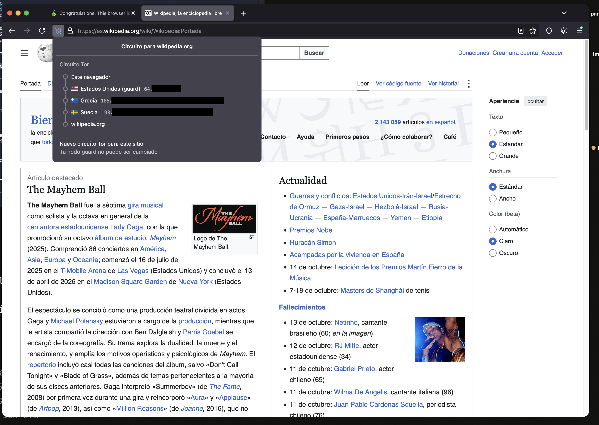
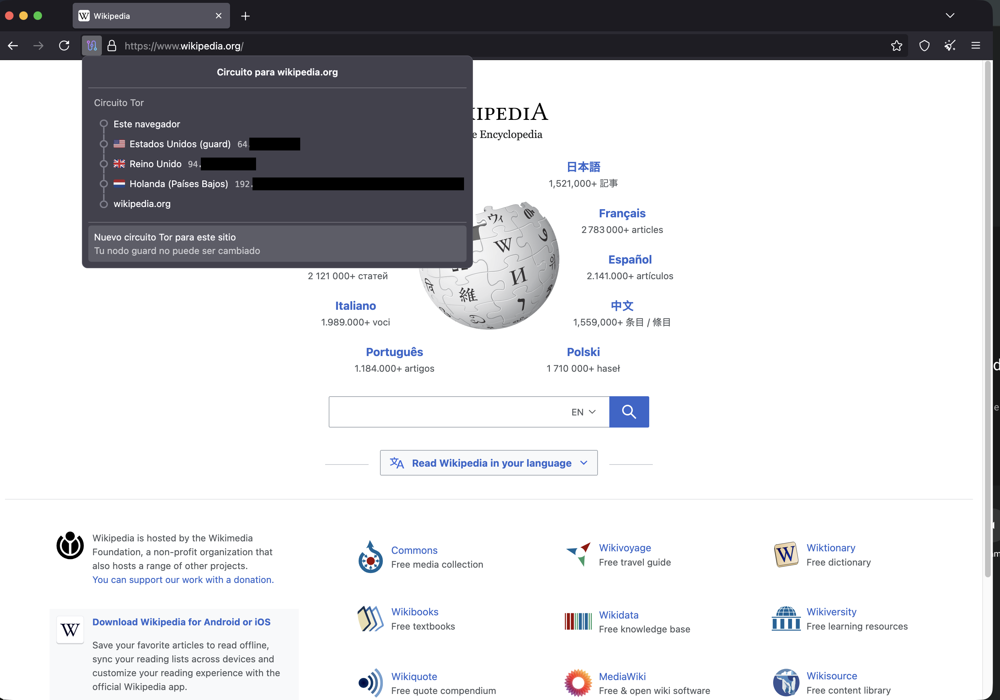

# Lab 17 — Tor Browser: circuit display + THREAT.md (Sesión 20)

- **Informe:** [THREAT.md](THREAT.md) (Solo HTTPS vs Tor vs I2P sobre el flow login → orden del venture)
- **Capturas (IPs tachadas):** [`captures/circuit-1.png`](captures/circuit-1.png) (circuit display) · [`captures/tor-check.png`](captures/tor-check.png) (check.torproject.org: conectado) · [`captures/normal-browser-check.png`](captures/normal-browser-check.png) (Brave: no Tor, IP real tachada) · [`captures/circuit-2-new-circuit.png`](captures/circuit-2-new-circuit.png) (tras "Nuevo circuito") · [`captures/circuit-2b-otro-guard.png`](captures/circuit-2b-otro-guard.png) (circuito con otro guard)

Stack: Tor Browser 15.0.24 oficial (firma Apple del Tor Project, Team ID `MADPSAYN6T`), configuración por defecto, sin bridges.

## Parte A — circuito real

Sitio: `https://es.wikipedia.org` (Tor Browser lo agrupa como `wikipedia.org`) · fecha/hora: 2026-10-13, 23:55 (GMT-6) · conexión verificada en `https://check.torproject.org` ("Congratulations. This browser is configured to use Tor.")

| Hop | Rol | País | IP (truncada) |
|---|---|---|---|
| 1 | Guard (entry) | Estados Unidos | `64.x.x.x` |
| 2 | Middle | Grecia | `185.x.x.x` (IPv4 + IPv6) |
| 3 | Exit | Suecia | `193.x.x.x` (IPv4 + IPv6) |
| 4 | Sitio | wikipedia.org (CDN de Wikimedia) | — |

**New Tor Circuit for this Site** (2026-10-14, 00:04, ahora en `www.wikipedia.org`):

| Hop | Circuito 1 (23:55) | Circuito nuevo (00:04:42) | ¿Cambió? |
|---|---|---|---|
| Guard | Estados Unidos `64.x` | Estados Unidos `64.x` | **No** (mismo relay) |
| Middle | Grecia `185.x` | Reino Unido `94.x` | Sí |
| Exit | Suecia `193.x` | Países Bajos `192.x` | Sí |

Cambiaron el middle y el exit; el sitio ahora ve una IP de salida holandesa en lugar de una sueca.
**No cambió el guard** (sigue en Estados Unidos, `64.x.x.x`). Es lo esperado; el propio panel lo dice: *"Tu nodo guard no puede ser cambiado"*. Tor fija un guard por meses para que un adversario
que controla algunos relays no termine, a fuerza de circuitos nuevos, siendo tu primer hop alguna vez.
Si el guard rotara en cada circuito, tarde o temprano caerías en uno malicioso.

**Observación extra:** 9 segundos antes (00:04:33, con la página aún cargando) el display mostró un circuito con
guard en **Finlandia** `188.x` → Alemania → Estados Unidos ([captura](captures/circuit-2b-otro-guard.png)).
Mi lectura, que no verifiqué en los logs de Tor: Tor no guarda un solo guard sino una lista corta de *primary
guards*, y puede usar el siguiente si el primero tarda o falla, o para circuitos auxiliares mientras arma uno nuevo.
Aun así, el guard viene siempre de esa misma lista estable, nunca de un relay al azar. Por eso el botón no
ofrece cambiarlo.

## Parte B — quién ve qué (mi circuito)

| Observador | Ve | No ve |
|---|---|---|
| Red local / ISP | Que me conecto a Tor (IP del guard), horarios, volumen | El sitio destino, el contenido |
| Guard | Mi IP real, que uso Tor, volumen/timing | El destino, el contenido (3 capas de cifrado; él quita solo una) |
| Middle | IP del guard e IP del exit | Mi IP, el destino, el contenido |
| Exit | IP del sitio + SNI (dominio), volumen/timing de la conexión | Mi IP; con HTTPS, la URL completa, cookies, formularios y respuesta |
| Sitio | IP del exit, todo lo que mande por HTTPS (login, cookies), fingerprint del navegador (homogéneo en Tor Browser) | Mi IP real |

**Contraste navegador normal** ([captura](captures/normal-browser-check.png), Brave, 00:06): check.torproject.org
responde *"Sorry. You are not using Tor."* y muestra mi IP pública real (`181.x`, tachada), la de mi ISP en
Guatemala. En Tor Browser, la misma página mostraba la IP de un exit (`171.x`). Con el navegador normal, el sitio ve mi IP real; la red local
y el ISP ven el dominio por DNS y SNI. El contenido sigue protegido por TLS en ambos casos. Lo que Tor
cambia es **quién conoce la pareja (yo, sitio)**: sin Tor la conocen ISP, red local y sitio; con Tor
ningún hop individual la conoce.

**Si el exit fuera malicioso, con este sitio HTTPS podría ver** el dominio (SNI/DNS que resuelve el exit),
la IP del servidor, cuándo y cuánto tráfico pasa **y no podría ver** la URL completa, mis credenciales,
cookies ni el contenido, ni mi IP real. Sí podría intentar un downgrade si el sitio no tuviera HSTS, o
correlacionar timing con alguien que observe mi lado.

**Chat de lab:** `connected: sí` · `el exit ve: dominio + IP del sitio + timing/volumen, no el contenido HTTPS ni mi IP`

> Si la red del aula bloqueó Tor: pegar aquí el error exacto de Tor Browser (p. ej. "Tor failed to establish
> a Tor network connection") y la hora; se repitió en la red autorizada por el instructor.
